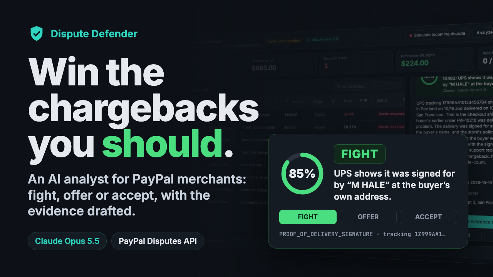

# Dispute Defender

**An AI chargeback analyst for PayPal merchants.** Claude investigates each PayPal dispute, decides whether to **fight, offer or accept**, and drafts the evidence. You approve it, and Dispute Defender sends the response through the PayPal Disputes API.

[](https://youtu.be/XTFwprwivak)

**[Watch the demo (2½ min)](https://youtu.be/XTFwprwivak)**

Built for the PayPal AI Hackathon.

## How it works

1. **Intake:** open disputes come in from the PayPal Disputes API (or a webhook) and land in a queue sorted by deadline.
2. **Investigate:** Claude checks the order, carrier tracking, support emails, refunds and store policy. Each lookup streams live in the UI.
3. **Decide:** Claude recommends FIGHT, OFFER or ACCEPT, with a win probability, cited facts, PayPal evidence items and a drafted statement.
4. **Respond:** you review or edit the plan, then one click calls `provide-evidence` (with an evidence PDF), `make-offer` or `accept-claim`.

Nothing is sent to PayPal without your approval.

## Run it

Requires Python 3.10+.

```bash
git clone https://github.com/palashpawar/dispute-defender && cd dispute-defender
python -m venv .venv && source .venv/bin/activate
pip install -r requirements.txt
cp .env.example .env   # add ANTHROPIC_API_KEY
uvicorn app.main:app --port 8000
```

Open http://localhost:8000.

- **No PayPal keys:** the app runs against a built-in mock sandbox with 9 demo disputes.
- **Real PayPal sandbox:**
  1. Add `PAYPAL_CLIENT_ID` and `PAYPAL_CLIENT_SECRET` from a sandbox app on [developer.paypal.com](https://developer.paypal.com) to `.env`.
  2. Buy something at `/shop` with your sandbox buyer account.
  3. Open a dispute on [sandbox.paypal.com](https://www.sandbox.paypal.com).
  4. Back in the app, use **Track dispute by ID** if the dispute doesn't show up in the queue yet.

## Built with

- **PayPal:** Disputes API, Orders API v2, JS SDK, Webhooks (sandbox)
- **Claude Opus 5.5:** tool-use agent with strict-schema output
- **AG Grid:** the dispute queue
- FastAPI, vanilla JS, fpdf2

Run the tests with `pip install -r requirements-dev.txt && pytest`.

## License

MIT. See [LICENSE](LICENSE).
